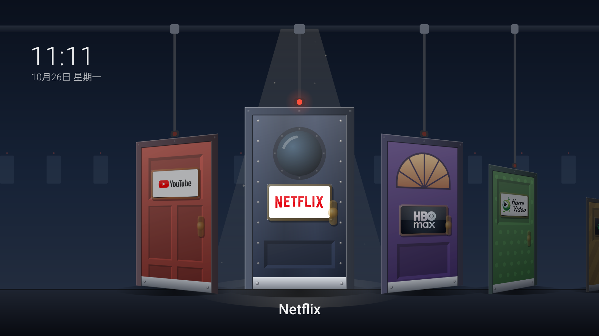

# PixarHomeTV · 門廳

[English](README.md) · **繁體中文**

一個 Android TV / Google TV 的首頁，每個 app 都是一扇門。


門掛在天花板的軌道上，就像《怪獸電力公司》裡的門庫。用遙控器沿著軌道左右滑動，停下來的那扇門會移到聚光燈下，
輕輕晃一下、門上的信號燈亮起。按下 OK，門就往內打開，溫暖的光灑到地板上，一隻小史萊姆怪物一跳一跳地鑽進門裡，
鏡頭跟著衝進去，app 就打開了。



## 靈感來源

這個專案是從 Gathin 的 [cleanYourTV](https://github.com/Gathin23/cleanyourtv) 出發的。cleanYourTV 透過 Wi-Fi
幫 Android TV 移除多餘的預裝程式，再把滿是廣告的首頁換成乾淨的 Apple TV 風格桌面。我先用它整理了家裡的電視，
之後想要一個更有個性的首頁。

延伸的點子是我自己的：皮克斯《怪獸電力公司》的工廠裡，每一扇衣櫃門都通往不同小孩的房間；
在這裡，每一扇門通往不同的 app。門、門廳和怪物都是用程式碼畫出來的原創設計。這是粉絲向的致敬作品，
與迪士尼、皮克斯沒有任何關係，也不包含任何電影裡的美術素材。

## 功能

- **一個 app 一扇門**：每扇門有自己的顏色和造型（鑲板門、木條門、圓窗鐵門、拱窗門、條紋門、點點門），
  黃銅門牌上是 app 真正的電視橫幅圖示。
- **一整排會滑動的門**：選到的門停在中間的聚光燈下，燈光裡有灰塵飄動；其他的門帶著透視角度轉向它，
  越遠越暗。
- **開門**：門板沿著鉸鏈立體地往內轉開，門裡的光會依照 app 的顏色變化，史萊姆怪物帶著壓扁拉長的彈跳和
  捲捲的尾巴跳進門，鏡頭跟著穿過門框。中途再按一次 OK 可以直接進入 app。
- **全部即時繪製**：不需要下載任何圖片或影片，APK 不到 30 KB。
- **接管 Home 鍵，又不影響音量鍵**：有些韌體沒辦法替換原廠首頁，`HomeRedirectService` 會偵測原廠首頁出現，
  把畫面帶回門廳。它完全不攔截按鍵，所以按住音量鍵依然能連續調整（在好幾款電視上，會攔截按鍵的無障礙服務
  會讓音量只能一格一格按）。
- **遙控器按鍵轉向**：把用不到的 app 快捷鍵改成打開你常用的 app。我們家把 Prime Video 鍵改成了 HBO Max 鍵。
- **設定門和「所有應用程式」門**：沒有自己的門的 app 都可以從這裡打開。

## 需求

- Android 8.0（API 26）以上的 Android TV / Google TV，並打開 USB 偵錯和網路偵錯。
- 同一個網路裡的一台電腦，安裝 JDK 17 和 Android SDK（platform 34、build-tools 34.0.0）。
- 在這個 repo 旁邊放一份 [cleanYourTV](https://github.com/Gathin23/cleanyourtv)，並建立好它的 Python venv
  （`python -m venv tools\venv`，再 `tools\venv\Scripts\pip install -r tools\requirements.txt`）。
  安裝腳本會用它的 ADB 工具（`tools/tv.py`），不需要另外安裝 `adb`。

測試機型：Panasonic 4KTV-3MUP（MOKA `R4_GTV`、Realtek、Google TV 14）。

## 安裝

```powershell
tools\install.ps1 -TvHost <電視 IP>
```

腳本會建置 APK、安裝到電視、設為偏好的首頁，並把 `HomeRedirectService` 設為唯一的無障礙服務。
第一次連線時，請在電視上允許「USB 偵錯」。

用完記得關掉 USB 偵錯和網路偵錯，因為 ADB 連線沒有加密。

## 設定門

編輯 [`app/src/main/assets/doors.json`](app/src/main/assets/doors.json)，再執行一次安裝腳本。

```json
{
  "doors": [
    {"target": "com.google.android.youtube.tv", "color": "#C9473C", "style": "panels"},
    {"target": "com.netflix.ninja", "color": "#2E3A55", "style": "porthole"},
    {"target": "@settings", "color": "#6E7480", "style": "porthole"},
    {"target": "@apps", "color": "#9A6A44", "style": "planks"}
  ],
  "app_redirects": {
    "com.amazon.amazonvideo.livingroom": "com.wbd.stream"
  }
}
```

- `target`：app 的套件名稱；`@settings` 是電視的設定，`@apps` 是所有 app 的清單。沒安裝的 app 不會出現門。
- `color`：門的顏色。
- `style`：`panels`、`planks`、`porthole`、`arched`、`stripes` 或 `dots`。
- `app_redirects`：第一個 app 被打開時（例如按了遙控器上的快捷鍵），改開第二個 app。從那個 app 按返回會回到門廳。

## 移除

在 設定 → 應用程式 解除安裝 **Door Hall**，並在 設定 → 協助工具 關掉 **Door Hall Home**，原廠首頁就會恢復。

## 授權

[Apache License 2.0](LICENSE)。`HomeRedirectService` 有部分改寫自 cleanYourTV 的 `HomeKeyService`
（MIT 授權），詳見 [NOTICE](NOTICE)。

《怪獸電力公司》（*Monsters, Inc.*）是迪士尼／皮克斯的商標。本專案與迪士尼、皮克斯無關，也未經其認可。
